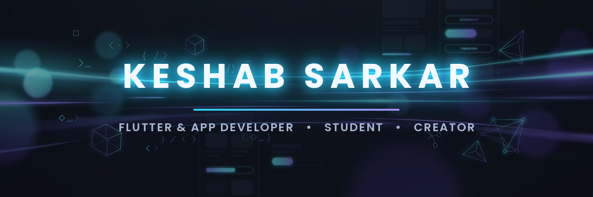

<!-- ══════════════════ HEADER ══════════════════ -->

[About](#-about-me) · [Projects](#-featured-projects) · [Flutter Studio](#-flutter-app-studio-toolkit) · [Stack](#️-tech-stack--skills) · [Stats](#-github-stats) · [Connect](#-lets-connect)

<h1> Hi there! I'm <b>Keshab Sarkar</b></h1>

  

### 🇮🇳 *Welcome! I'm from West Bengal, India — I build apps with Flutter, for students.* 🇮🇳

  
  
  

##  About Me

> *"Dream big. Work even harder. Stay humble."* ✨

<table>
  <tr>
    <td width="50%" valign="top">
      <h3>🚀 Currently Working On</h3>
      
Flutter & Dart Apps AI-Powered Tools Student Education Apps

    </td>
    <td width="50%" valign="top">
      <h3>🏆 Expert In</h3>
      
Flutter App Development Beautiful & Clean UI/UX Firebase-backed Apps

    </td>
  </tr>
  <tr>
    <td width="50%" valign="top">
      <h3>🤝 Looking to Collaborate</h3>
      
Mobile Apps & EdTech AI-powered Tools Open Source Projects

    </td>
    <td width="50%" valign="top">
      <h3>💬 Ask Me About</h3>
      
Flutter / Dart / Android Building & Publishing Apps Study Tools for Students

    </td>
  </tr>
</table>

## 🛠️ Tech Stack & Skills

### 📱 Mobile Development

### 🌐 Web Development

### 🤖 AI & Tools

## 🚀 Featured Projects

<table>
  <tr>
    <td width="50%" valign="top">
      <h3 align="center">🗣️ SpeakEasy</h3>
      
<b>AI English Speaking Partner</b> — full Flutter app for Bengali speakers: 70+ grammar lessons, AI conversation, listening practice & gamification.

      

        
        
        
      

    </td>
    <td width="50%" valign="top">
      <h3 align="center">🎯 Quizbaaz</h3>
      
<b>Premium 3D Gamified Quiz App</b> — chapter question bank, daily live quizzes, champion gifts, streaks & full admin panel.

      

        
        
        
      

    </td>
  </tr>
  <tr><td colspan="2"></td></tr>
  <tr>
    <td width="50%" valign="top">
      <h3 align="center">📸 Docify</h3>
      
<b>Photo, PDF & CV Toolkit</b> — resize photos & signatures, compress PDFs, build CVs — all in one Flutter app.

      

        
        
        
      

    </td>
    <td width="50%" valign="top">
      <h3 align="center">🧠 KeepIt</h3>
      
<b>AI Second Brain & Bookmark Manager</b> — save, organize & rediscover anything with smart AI-powered visual bookmarks.

      

        
        
        
      

    </td>
  </tr>
  <tr><td colspan="2"></td></tr>
  <tr>
    <td width="50%" valign="top">
      <h3 align="center">📚 Study With Keshab</h3>
      
<b>বাংলা Study Hub</b> — MCQ quizzes, practice sets, current affairs & CBT exam platform for students.

      

        
        
        
      

    </td>
    <td width="50%" valign="top">
      <h3 align="center">🤖 AI Image Scan</h3>
      
<b>AI MCQ Scanner</b> — ছবির প্রশ্ন বাংলায় সমাধান করে — Gemini API-চালিত scanner built for real study needs.

      

        
        
        
      

    </td>
  </tr>
</table>

## 🧰 Flutter App Studio Toolkit

> *Complete 39-repo Flutter ecosystem — from 1-click app creation, CI/CD, Play Store + GitHub auto-updaters, universal UI/UX kits, and Play Store compliance to Bangla localization, UPI & PDF billing, AI quota/caching, offline-to-cloud sync (Supabase & Firebase), and Play Store launch automation.*

  
  

| # | Repository | Category | What It Does |
| :-: | :--- | :---: | :--- |
| **01** | [**`flutter-app-starter`**](https://github.com/Keshab1997/flutter-app-starter) |  | **1-click Flutter GitHub Template** — pre-wires 8 core kits + 1-click presets (`universal_ux`, `finance_vault`, `scanner_ai`, `quiz_learning`, `cloud_supabase`, `all_kits`) across all 33 companion kits |
| **02** | [**`flutter-builder`**](https://github.com/Keshab1997/flutter-builder) |  | **Central CI & Agent Pack** — reusable GitHub Actions workflows, preflight checks, screenshot tooling, kit selection playbook & `sync-pulse-config.py` |
| **03** | [**`app_pulse_kit`**](https://github.com/Keshab1997/app_pulse_kit) |  | **Remote Control Kit** — zero-cost soft/force updates, maintenance screen, scheduled in-app notices & feature flags (EN/বাংলা UI) |
| **04** | [**`pulse-control-panel`**](https://github.com/Keshab1997/pulse-control-panel) |  | **Single Web Control Panel** — static zero-backend dashboard to manage `pulse.json` across all Flutter apps from one screen |
| **05** | [**`smart_review_feedback`**](https://github.com/Keshab1997/smart_review_feedback) |  | **Smart Rating Gate** — 4–5★ → Play Store In-App Review; 1–3★ → private feedback form with auto device diagnostics (EN/বাংলা) |
| **06** | [**`bangla_kit`**](https://github.com/Keshab1997/bangla_kit) |  | **Bengali & Indian Toolkit** — zero-dependency `₹`/`৳` Lakh-Crore currency, Bangla digits, number-to-words, Bangla dates & deadline chips |
| **07** | [**`local_vault_backup`**](https://github.com/Keshab1997/local_vault_backup) |  | **Offline Encrypted Backup** — pure-Dart password encryption, SHA-256 integrity checks, schema migrations & Material 3 EN/বাংলা UI |
| **08** | [**`smart_ad_kit`**](https://github.com/Keshab1997/smart_ad_kit) |  | **Safe AdMob Kit** — automatic debug test IDs, interstitial capping & grace period, adaptive banners, EN/বাংলা rewarded prompts & `app_pulse_kit` kill-switch |
| **09** | [**`smart_paywall_pro_kit`**](https://github.com/Keshab1997/smart_paywall_pro_kit) |  | **Pro Paywall & VIP Codes** — Material 3 Pro upgrade sheet, 24h rewarded ad-free pass, offline SHA-256 promo codes & pluggable billing (EN/বাংলা) |
| **10** | [**`smart_notify_kit`**](https://github.com/Keshab1997/smart_notify_kit) |  | **Reminders & Deadline Alerts** — daily streaks, job/exam deadline alerts, Quiet Hours (11 PM–7 AM), EN/বাংলা permission dialog & `ReminderSettingsTile` |
| **11** | [**`smart_streaks_gamify_kit`**](https://github.com/Keshab1997/smart_streaks_gamify_kit) |  | **Daily Streaks & XP Levels** — automatic streak freeze shields, XP leveling, milestone celebrations & 7-day strip with বাংলা digits |
| **12** | [**`smart_share_card`**](https://github.com/Keshab1997/smart_share_card) |  | **Viral Branded Share Cards** — zero-dependency 3× PNG export for Quiz Score, Job Alert, Expense Summary & Streak cards with EN/বাংলা captions |
| **13** | [**`smart_onboarding_kit`**](https://github.com/Keshab1997/smart_onboarding_kit) |  | **Onboarding & What's New** — live EN/বাংলা language switcher inside Material 3 slides + automatic version-aware release highlights sheet |
| **14** | [**`smart_crash_diagnostics_kit`**](https://github.com/Keshab1997/smart_crash_diagnostics_kit) |  | **Offline Crash & Debug Log** — zero-Firebase error ring-buffer with API-key/Bearer/email scrubbing, breadcrumbs & 1-tap Copy Debug Report (EN/বাংলা) |
| **15** | [**`smart_legal_consent_kit`**](https://github.com/Keshab1997/smart_legal_consent_kit) |  | **Play Store Policy & Data Wipe** — offline Privacy/Terms reader, medical/financial/AI disclaimers, mandatory AI output flag sheet & 2-step Delete All Data |
| **16** | [**`smart_app_lock_kit`**](https://github.com/Keshab1997/smart_app_lock_kit) |  | **PIN & Biometric App Lock** — salted SHA-256 PIN vault, pluggable fingerprint unlock, auto-lock on background & EN/বাংলা lock gate |
| **17** | [**`smart_pdf_export_kit`**](https://github.com/Keshab1997/smart_pdf_export_kit) |  | **Bangla-Safe PDF Exporter** — pure-Dart crash-safe PDF generator for ledger/khata tables, POS receipts & multi-page document scans (`₹`/`৳` ready) |
| **18** | [**`smart_upi_qr_kit`**](https://github.com/Keshab1997/smart_upi_qr_kit) |  | **UPI Payment QR & Invoice Math** — NPCI `upi://pay` vector QR card (GPay/PhonePe/Paytm) + discount, CGST/SGST, bill-split & cash-change calculator |
| **19** | [**`smart_charts_stats_kit`**](https://github.com/Keshab1997/smart_charts_stats_kit) |  | **Zero-Dep CustomPainter Charts** — lightweight Bar, Donut, Trend Sparkline & Progress Ring charts with বাংলা digits & Indian `₹`/`৳` Lakh/Crore labels |
| **20** | [**`smart_csv_whatsapp_kit`**](https://github.com/Keshab1997/smart_csv_whatsapp_kit) |  | **Excel Bangla CSV & WhatsApp Kit** — UTF-8 BOM CSV import/export (intact বাংলা in Excel) + formatted WhatsApp payment reminder & daily khata summary |
| **21** | [**`smart_quiz_flashcard_kit`**](https://github.com/Keshab1997/smart_quiz_flashcard_kit) |  | **MCQ Exam & SM-2 Flashcards** — negative marking (`-0.25`/`-0.33`), persistent Mistake Bank & SuperMemo SM-2 spaced-repetition flashcards (EN/বাংলা) |
| **22** | [**`smart_voice_speech_kit`**](https://github.com/Keshab1997/smart_voice_speech_kit) |  | **EN/বাংলা Voice & Speech Kit** — automatic Bangla/English script detection, danda (`।`) sentence chunking, learner speed presets (`0.75x`–`1.25x`) & STT |
| **23** | [**`smart_ai_chat_kit`**](https://github.com/Keshab1997/smart_ai_chat_kit) |  | **AI Quota, Cache & Chat UI** — daily free AI limit, rewarded-ad credit top-up, 0-token SHA-256 offline prompt cache & Material 3 EN/বাংলা chat view |
| **24** | [**`smart_image_prep_kit`**](https://github.com/Keshab1997/smart_image_prep_kit) |  | **AI Token-Saver Image Prep** — pure-Dart EXIF orientation fix, smart downscaling, high-contrast B&W prescription/receipt scan filter & Base64 compressor |
| **25** | [**`smart_ocr_ai_bridge`**](https://github.com/Keshab1997/smart_ocr_ai_bridge) |  | **On-Device OCR + AI Bridge** — 5-script ML Kit OCR paired with auto-failover to cut LLM vision token usage by ~90% |
| **26** | [**`admin_api_key_manager`**](https://github.com/Keshab1997/admin_api_key_manager) |  | **API Key Pool & Failover** — Firestore-backed admin API key rotation with cooldowns, health checks & management UI |
| **27** | [**`smart_cloud_sync_kit`**](https://github.com/Keshab1997/smart_cloud_sync_kit) |  | **Offline-to-Cloud Sync Engine** — persistent outbox compaction, HLC Last-Write-Wins conflict resolution, delta pull cursors & EN/বাংলা sync pill |
| **28** | [**`smart_supabase_kit`**](https://github.com/Keshab1997/smart_supabase_kit) |  | **Zero-Gradle Supabase Kit** — Safe-Boot offline fallback, Email/OTP/Guest Auth, PostgREST sync, Play Store account deletion & ready Postgres RLS SQL |
| **29** | [**`smart_firebase_kit`**](https://github.com/Keshab1997/smart_firebase_kit) |  | **Safe-Boot Firebase Kit** — zero-crash boot without `google-services.json`, Guest → Email `uid` linking, 450-op Firestore batch sync & Play Store account wipe |
| **30** | [**`smart_game_hud_kit`**](https://github.com/Keshab1997/smart_game_hud_kit) |  | **Casual Game HUD & Revive** — persistent high-score & coin wallet, pause/game-over overlays & 1-per-run rewarded-ad revive controller (EN/বাংলা) |
| **31** | [**`smart_state_views_kit`**](https://github.com/Keshab1997/smart_state_views_kit) |  | **Async Skeleton, Empty & Retry UI** — `pumpAndSettle`-safe shimmer loader, Material 3 empty states, offline retry & `SmartAsyncStateView` (EN/বাংলা) |
| **32** | [**`smart_form_inputs_kit`**](https://github.com/Keshab1997/smart_form_inputs_kit) |  | **Bangla-Safe Inputs & Validators** — `০-৯` & `0-9` number/currency parser, India/BD mobile & UPI validators, and quick-chip `SmartAmountField` |
| **33** | [**`smart_search_filter_kit`**](https://github.com/Keshab1997/smart_search_filter_kit) |  | **Smart Search & Date Filter Bar** — bidirectional `500` ↔ `৫০০` search matcher, persistent recent chips, date-range strip & sort sheet (EN/বাংলা) |
| **34** | [**`smart_permission_kit`**](https://github.com/Keshab1997/smart_permission_kit) |  | **Play Store Permission & Recovery** — Prominent Disclosure rationale bottom sheet, permanent-denial App Settings guide & pluggable gateway (EN/বাংলা) |
| **35** | [**`smart_help_faq_kit`**](https://github.com/Keshab1997/smart_help_faq_kit) |  | **Offline FAQ, Tips & Support Card** — searchable EN/বাংলা FAQ center, dismissible contextual quick-tip coach banners & 1-tap WhatsApp/email support |
| **36** | [**`smart_app_updater_kit`**](https://github.com/Keshab1997/smart_app_updater_kit) |  | **Play Store + GitHub Auto-Updater** — native Play Flexible In-App Update + GitHub Release/`v*` tag `.apk` updater with calm EN/বাংলা Update Center |
| **37** | [**`store_launch_kit`**](https://github.com/Keshab1997/store_launch_kit) |  | **Zero-Canva Play Store Pack** — 1-command Feature Graphic (`1024×500`), framed Screenshots (`1080×1920`), `512×512` icon & EN/বাংলা Release Notes |
| **38** | [**`flutter-bootstrap`**](https://github.com/Keshab1997/flutter-bootstrap) |  | **40s Flutter SDK Setup** — gives any fresh AI-agent sandbox a SHA-256-verified Flutter SDK with zero manual setup |
| **39** | [**`agent-bootstrap`**](https://github.com/Keshab1997/agent-bootstrap) |  | **Zero-Secret Agent Pairing** — one-step GitHub OAuth device-flow pairing for AI coding agents |

## 📊 GitHub Stats

<table>
  <tr>
    <td width="50%" valign="top">
      
       
      
       
      
    </td>
    <td width="50%" valign="center">
      
    </td>
  </tr>
</table>

## 📈 Activity Graph

## 🎯 Current Focus

- **📱 Mobile Apps:** Polishing Flutter apps that solve real problems for students
- **🤖 AI Integration:** Gemini & OpenAI powered features inside everyday apps
- **📚 EdTech:** *Study With Keshab* — Bangla learning tools, quizzes & exam practice
- **🌱 Learning:** Advanced Flutter architecture, animations & clean UI craft

## 🐍 Contribution Snake

### Watch my contribution snake eat the commits! 🍒

<picture>
  <source media="(prefers-color-scheme: dark)" srcset="https://raw.githubusercontent.com/Keshab1997/Keshab1997/output/github-snake-dark.svg">
  <source media="(prefers-color-scheme: light)" srcset="https://raw.githubusercontent.com/Keshab1997/Keshab1997/output/github-snake.svg">
  
</picture>

## 📫 Let's Connect!

**🚀 Let's build something amazing together!**

  

 

